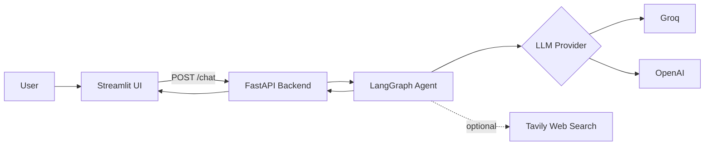

<div align="center">

# 🤖 LangGraph AI Agent Chatbot 
Link => http://localhost:1234

**A multi-provider AI agent with real-time web search, a REST API and a Docker-ready deployment.**


</div>

---

## 📌 Overview

This project is an **AI agent** built with LangGraph and LangChain. Users choose a model provider (Groq or OpenAI), write a custom system prompt to define the agent's role, and optionally let the agent search the web through Tavily before answering. A FastAPI backend serves the agent over a REST API, a Streamlit app provides the interface, and Docker packages everything for deployment.

## ❗ Problem Statement

Standard LLM chatbots have three main limitations:

| Problem | Impact |
| --- | --- |
| **Outdated knowledge** | Models only know their training data, so they cannot answer questions about recent events, prices or news. |
| **Fixed behavior** | A hard-coded persona cannot be adapted to different roles, tones or tasks. |
| **Vendor lock-in** | Apps tied to one provider are difficult to switch or compare when cost, speed or quality changes. |

**How this project solves them**

- ✅ **Real-time search:** the agent calls Tavily when it needs current information.
- ✅ **Configurable behavior:** a custom system prompt defines the agent's role at runtime.
- ✅ **Provider flexibility:** users switch between Groq and OpenAI models from the UI.
- ✅ **Reusable API:** the agent is exposed through a REST endpoint any client can call.

## 🧠 What Is an AI Agent?

An **AI agent** is a system built around a large language model that can reason about a goal, decide which action to take, use external tools, and observe the results before producing a final answer. A plain chatbot only generates text from what it already knows. An agent can act.

| Component | Role in this project |
| --- | --- |
| **Model (the brain)** | Groq or OpenAI LLM that reasons and writes responses |
| **Instructions** | The system prompt that defines the agent's role and behavior |
| **Tools** | Tavily web search, used when current information is needed |
| **Orchestration** | LangGraph, which manages the loop of thinking, calling tools and responding |

**Example:** asked "What are the latest developments in AI regulation?", the agent recognizes its knowledge may be outdated, calls the search tool, reads the results, and answers from fresh sources. Asked "Explain recursion", it answers directly without searching.

## 🏗️ Architecture



## ✨ Features

- Switch between **Groq** and **OpenAI** models at runtime
- Custom **system prompt** to control agent behavior
- Optional **live web search** with Tavily
- **FastAPI** backend with Pydantic validation and Swagger docs
- Clean **Streamlit** interface
- **Docker** support for portable deployment

## 🛠️ Tech Stack

| Layer | Technology |
| --- | --- |
| Agent framework | LangGraph, LangChain |
| LLM providers | Groq, OpenAI |
| Search tool | Tavily |
| Backend | FastAPI, Uvicorn, Pydantic |
| Frontend | Streamlit |
| Deployment | Docker, Docker Hub |

## 📁 Project Structure

```
.
├── ai_agent.py        # Agent logic: LLM setup, tools, response handling
├── backend.py         # FastAPI server exposing POST /chat
├── frontend.py        # Streamlit user interface
├── Dockerfile         # Container build instructions
├── .dockerignore
├── Pipfile
├── Pipfile.lock
└── .env               # API keys (never committed)
```

## 🚀 Getting Started

### Prerequisites

- Python 3.12
- API keys for [Groq](https://console.groq.com), [OpenAI](https://platform.openai.com) and [Tavily](https://tavily.com)

### 1. Clone the repository

```bash
git clone https://github.com/YOUR_USERNAME/YOUR_REPO.git
cd YOUR_REPO
```

### 2. Configure environment variables

Create a `.env` file in the project root:

```env
GROQ_API_KEY=your_groq_key
OPENAI_API_KEY=your_openai_key
TAVILY_API_KEY=your_tavily_key
```

### 3. Install dependencies

```bash
pip install pipenv
pipenv install
```

### 4. Start the backend

```bash
pipenv run python backend.py
```

API: `http://127.0.0.1:1000` · Swagger docs: `http://127.0.0.1:1000/docs`

### 5. Start the frontend

In a second terminal:

```bash
pipenv run streamlit run frontend.py
```

Open `http://localhost:8501`.

## 🐳 Docker

**Build and run locally**

```bash
docker build -t langgraph-agent .
docker run -d --name agent --restart unless-stopped -p 8501:8501 --env-file .env langgraph-agent
```

**Push to Docker Hub**

```bash
docker login
docker tag langgraph-agent YOUR_DOCKERHUB_USERNAME/langgraph-agent:1.0.0
docker push YOUR_DOCKERHUB_USERNAME/langgraph-agent:1.0.0
```

**Pull and run on any machine**

```bash
docker pull YOUR_DOCKERHUB_USERNAME/langgraph-agent:1.0.0
docker run -d --name agent --restart unless-stopped -p 8501:8501 --env-file .env YOUR_DOCKERHUB_USERNAME/langgraph-agent:1.0.0
```

## 📡 API Reference

### `POST /chat`

**Request**

```json
{
  "model_name": "openai/gpt-oss-120b",
  "model_provider": "groq",
  "system_prompt": "You are a helpful assistant.",
  "messages": ["What is LangGraph?"],
  "allow_search": true
}
```

**Response**

```json
{
  "response": "LangGraph is a library for building stateful, multi-step AI agents..."
}
```

**Errors**

| Case | Response |
| --- | --- |
| Unsupported model name | `{"error": "Invalid model name. Kindly Select a valid Ai model."}` |

## 🔄 How It Works

1. The user enters a system prompt and a question in the Streamlit UI.
2. The frontend sends the request to the FastAPI `/chat` endpoint.
3. The backend validates the model name and builds a LangGraph agent with the chosen LLM.
4. If web search is enabled, the agent can call Tavily for current information.
5. The final AI message is returned and displayed in the UI.

## 🔒 Security Notes

- Store API keys in environment variables and never commit `.env` to Git.
- The app has no built-in authentication. Add one before exposing it publicly, because anyone with the URL can spend your API credits.
- Set spending limits on your provider accounts.

## 🗺️ Roadmap

- [ ] Conversation memory across messages
- [ ] Streaming responses
- [ ] User authentication
- [ ] Separate backend and frontend containers with Docker Compose
- [ ] Additional tools (calculator, file reader, database queries)

## 🎯 Skills Demonstrated

- Designing agentic workflows with LangGraph and LangChain
- Integrating multiple LLM providers behind one interface
- Tool use with live web search
- Building and validating REST APIs with FastAPI and Pydantic
- Containerizing and distributing applications with Docker

## 📄 License

Released under the MIT License.

## 👤 Author

**Your Name**
[Portfolio](https://atifkhan7portfolio.netlify.app/) · [LinkedIn](https://www.linkedin.com/in/atif-khan-92b4ba274/?isSelfProfile=true)
